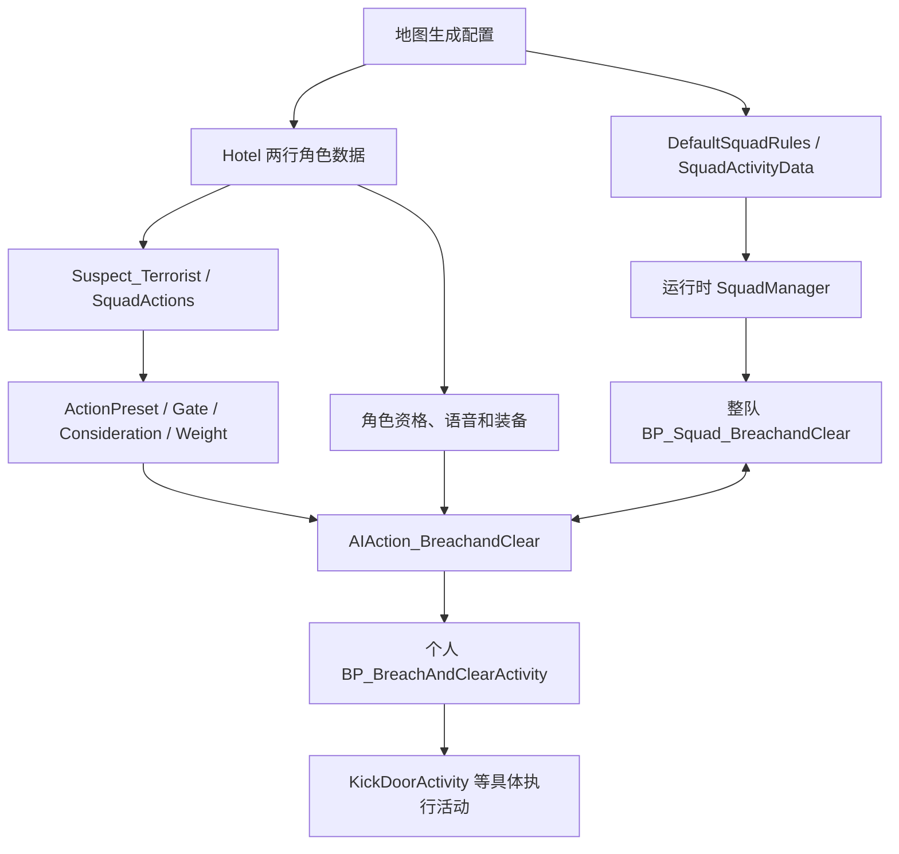

# AI 目录怎样共同驱动一次破门

本章以父之罪阶段12 `Sins-MLOBreach-HighWeight-StingerAlways-r1` 为例，解释已追踪的破门路径。依据为 RON 1.5.3、UE 5.3.2 的官方资产、字节码和项目记录；范围不等于整个游戏 AI 已被还原，也不包含后续的 2–4 人抱团实验。

## 目录是资源分类，引用才把行为接起来

游戏没有“先执行 Archetypes 文件夹，再执行 Actions 文件夹”的固定顺序。资源保存配置、对象引用及已编译逻辑；加载后，原生代码与蓝图事件据此创建、选择和更新运行对象。

| 目录 | 职责与本次例子 |
|---|---|
| `Archetypes` | 角色原型。`Suspect_Terrorist.SquadActions` 把小队角色标签映射到动作预设。 |
| `ActionPresets` | 动作配置，连接实现、Gate、Consideration 和 Weight；如 `AP_Breach_Leader`、`AP_Breach_Follower`、`AP_SoloBreach`。 |
| `Gates` | 判断动作资格。需连同实例参数、组合和取反方式阅读，不能只凭条件类名判断结果。 |
| `Considerations` | 提供行为评估输入或评分。领队预设使用 `AC_ConstantOne`；最终竞争方式还涉及原生调度。 |
| `Actions` | 行为开始、更新、结束的衔接。`AIAction_BreachandClear` 创建并交付个人活动，关联小队和结束回调。 |
| `AIActionActivity` | 个人活动实现。`BP_BreachAndClearActivity` 负责一个角色怎样参与破门。 |
| `Squads` | 小队规则及活动。规则的 `SquadActivityData` 列出候选活动；运行时 `SquadManager` 管理成员与当前小队活动。 |
| `CombatMoves` | 战斗移动资源，如找掩体、向敌方位置推进；本次未逐项还原调用链。 |
| `FactionManagers` | 阵营相关资源，如 `Faction_MLO`；阵营不等于小队，改阵营也不会自动接通破门。 |

Gate 可理解为“能否参与评估”，Consideration 为评估提供输入，Weight 影响候选竞争。阶段12三个破门预设的根 Weight 为20，但它不是20%概率，也没有证明实际触发率变为四倍。提高权重不会绕过保留的资格条件。

## 从父之罪的实际入口看引用

入口要从地图生成配置查起。父之罪 `RoN_Sins_Core` 的相关生成配置引用 `AIDataTable_Hotel` 两行 `sp_m_shooter_a`、`sp_m_shooter_c`；它们使用 `Suspect_Terrorist`，小队配置使用 `DefaultSquadRules`。表名带 Hotel 不妨碍别的地图引用它。

箭头表达依赖和衔接，不是每帧严格串行执行。小队与个人会相互查询、回调；装备也供后续执行使用。

核心接入保留原项：`DefaultSquadRules` 原有三个活动后追加官方 BreachandClear、SoloBreach；Terrorist 原七项 SquadActions 已有 Support，再补 Leader、Solo。Hotel 两行追加三种破门角色资格，各八个模型的语音标识改为 `TowerMLO_01`。这接通了候选路径，不能单凭配置宣布角色已经踢门。

`BP_Squad_BreachandClear` 协调整队的目标门、成员和阶段；`BP_BreachAndClearActivity` 属于个人；`KickDoorActivity` 才是更具体的踢门执行活动。三者不能互换。对象加载、字段持有活动引用、活动成为当前执行项、画面出现脚踢，也分别是不同证据。旧版采样与用户回放支持部分角色实际踢门，不能由此认定阶段12的完整列队、投弹、入室或所有成员协同都已通过。

## 阶段12增加了什么

两行合计五套 `WeaponLoadouts` 的 `Grenades` 数组，各加入三个官方 `Grenade_Stinger_V2_C` 引用。它不放在 `Primary` 或 `ForcedAIItems`。五套是备选装备配置，每套三枚，不是每人十五枚。

小队蓝图 `SetCanUseItem` 改为 `CanUseItem=true` 后返回，原流程继续把许可交给 `SetUseGrenade`，沿用破门及用物品阶段。目标是“列队→踢门→刺痛弹→入室”，指定投掷成员仍由原逻辑决定。许可为真不保证投出：库存、投掷位置、原生执行条件和中断仍可能阻止动作；Solo 与普通开门流程没有因此修改。

实际结构复制和 Kismet 修改使用 UAssetAPI 工具；UAssetGUI 用于字段检查，并非拖动蓝图节点完成这些改动。操作方法见 [UAssetGUI 字段检查指南](./UASSETGUI-GUIDE.zh-CN.md)。阶段12离线包检查通过，完整行为与联机仍未验证；其他 UE4SS 反击项目的客机结果不能作为本项目证据。

## 这次改了哪些目录、哪些未改

下表指阶段12游戏资产范围；本章本身只是一份说明文档。共享原型、规则、预设及小队蓝图也可能影响其他消费者，不能宣称影响完全隔离于父之罪。

| 目录或资源 | 阶段12累计变化 |
|---|---|
| `Archetypes/Core` | 修改 Terrorist，补 Leader、Solo 映射。 |
| `Squads` | 修改 Default 规则追加两项活动，并修改小队破门投掷许可函数。 |
| `ActionPresets` | 修改三个破门预设根 Weight 为20；未改 Regroup 权重。 |
| `DataTables/AI` | 修改 Hotel 两行资格、16项语音标识及五套手雷配置。 |
| `Gates`、`Considerations` | 未修改资产或清空条件。 |
| `Actions`、`AIActionActivity` | 未替换动作与个人活动资产。 |
| `CombatMoves`、`FactionManagers` | 未修改。 |
| 地图、原生程序、公共动画 | 未修改；保留 Kick=3，未加入抱团人数或集合超时改动。 |
