# 从 MLO 接通其他地图的列队、踢门和投弹

这份教程按本项目真实改过的资产写，以《父之罪》阶段12“高权重、踢门后启用刺痛弹”版本为例。先接通小队活动，再补装备和投掷许可。后续的2～4人抱团、12秒集合超时、破门锤、C2实验不属于这里的配置。

截图是在 UAssetGUI 中重新打开对应结果资产所得，展示修改后的字段；截图本身不代表一轮新游戏测试。截图文件和打开路径见[截图索引](SCREENSHOTS.md)。

## 0. 准备与查入口

本项目按 UE **5.3.2** 解析，UAssetGUI 界面版本选择 **5.3**，映射为 `Mappings V1.5.3(2026.10.14).usmap`。先备份从自己游戏中提取的文件，保留 `.uasset` 与 `.uexp` 配对，以及完整依赖目录。不要把单个资产能显示几个字段当成整个包都能正确保存；遇到缺依赖、未解析导出或原始字节码回退，先解决这些问题再做写入。

先从地图的生成配置查到下面三个问题，而不是直接修改所有 AI：

| 问题 | 本次父之罪的实际答案 |
| --- | --- |
| 生成哪张表的哪行？ | `AIDataTable_Hotel` 的 `sp_m_shooter_a`、`sp_m_shooter_c` |
| 这两行使用哪个原型？ | `Suspect_Terrorist`，本次核对而不替换这一字段 |
| 小队使用哪套规则？ | `DefaultSquadRules`，地图已有 `squad1..8` 配置 |

父之罪显示名对应 Sins / `RoN_Sins_Core`，并非 Penthouse。生成文件中的41条嫌疑人配置是候选点记录，不是每局必生成41个人。表叫 Hotel 也不代表只给 Hotel 地图使用。

其他地图也按这个方法找真实引用。若它没有合适的同队成员、规则或生成配置，仅修改下面某一个文件未必接得上。本项目没有把“父之罪成功”扩大为所有原版地图已完成。

下面的路径均以 `ReadyOrNot/Content/` 为根；运行时的 `/Game/` 引用对应这个 Content 根。

## 1. 给小队规则追加可选活动

打开：

```text
Blueprints/AI/Squads/DefaultSquadRules.uasset
```

真实截图中的树路径：

```text
Export Data
  → Export 2 (DefaultSquadRules)
    → SquadRulesData
      → SquadActivityData (5)
```

保留原来的前三项 Rally、ExecuteHostages、Regroup，从同版本官方 `MLO_SquadRules` 复制完整的活动项。当前版本源索引为4、5，追加到 Default 的3、4；索引只描述这份版本，应以类路径再次核对。

| 目标索引 | `SquadsActivityClass` 的完整引用 |
| --- | --- |
| 3 | `/Game/Blueprints/AI/Squads/SquadActivities/BP_Squad_BreachandClear.BP_Squad_BreachandClear_C` |
| 4 | `/Game/Blueprints/AI/Squads/SquadActivities/BP_Squad_SoloBreach.BP_Squad_SoloBreach_C` |

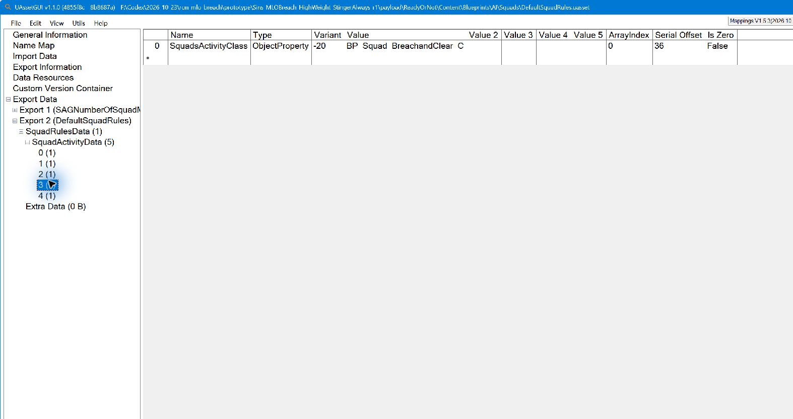

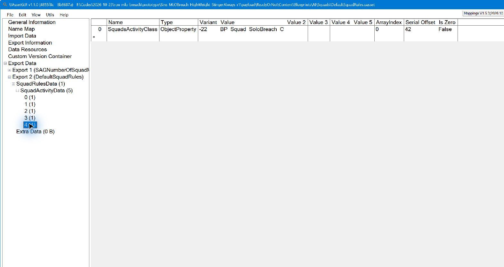

这一步是让小队管理器具备破门候选活动。资产字段叫 `SquadActivityData`；运行时管理器的 `SquadActivities`、`ActiveSquadActivity` 是另一层对象状态，不能混用字段名。

`SquadsActivityClass` 是对象/类引用。GUI 显示的负数索引属于当前包的 ImportMap，不能把来源包里的负数直接抄进另一个包。本项目使用 UAssetAPI 复制完整项并处理名称、导入和依赖，然后核对解析出的完整类路径。

## 2. 给角色原型补 Leader、Solo 动作映射

打开：

```text
Blueprints/AI/Archetypes/Core/Suspect_Terrorist.uasset
```

截图路径为 `Export Data → Export 148 (Suspect_Terrorist) → AIArchetypeData → SquadActions`。原来有7项，其中已经有 `Squads.BreachAndClear.Support`，对应 `AP_Breach_Follower`。保留原7项，再从官方 `Suspect_Tactical` 复制 Leader、Solo 两项，得到9项。导出号只适用于当前这份资产。

| 目标项 | `ActionTag → TagName` | `Preset` |
| --- | --- | --- |
| 原索引5，保留 | `Squads.BreachAndClear.Support` | `/Game/Blueprints/AI/ActionPresets/AP_Breach_Follower.AP_Breach_Follower` |
| 新索引7 | `Squads.BreachAndClear.Leader` | `/Game/Blueprints/AI/ActionPresets/AP_Breach_Leader.AP_Breach_Leader` |
| 新索引8 | `Squads.BreachAndClear.Solo` | `/Game/Blueprints/AI/ActionPresets/AP_SoloBreach.AP_SoloBreach` |

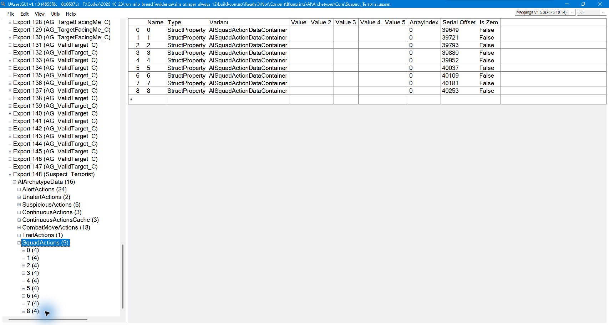

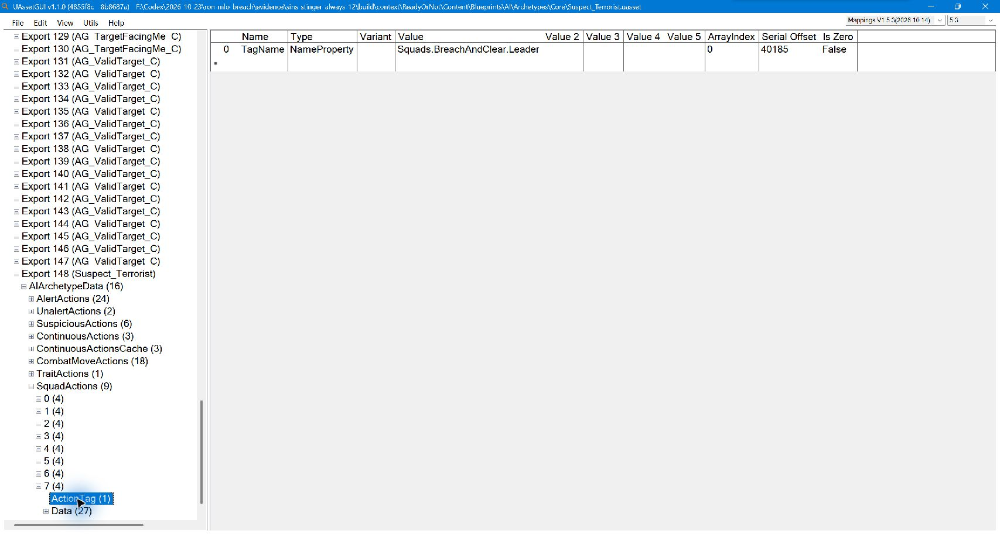

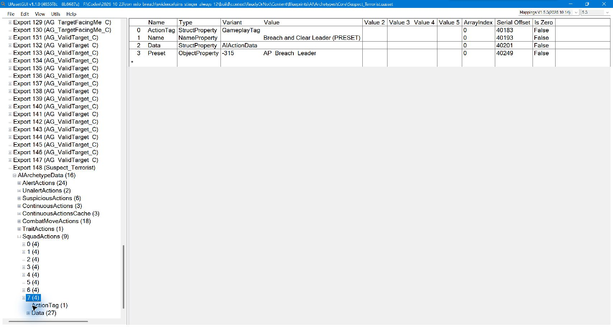

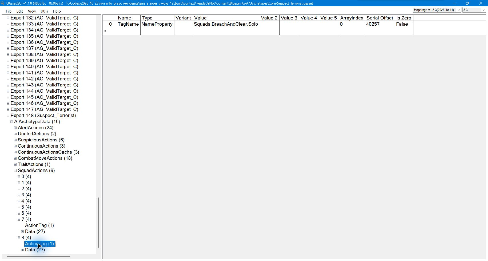

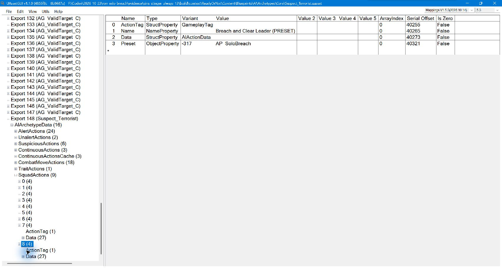

完整项还带有 `Data` 等结构；本项目没有只改显示文字。以 `ActionTag` 与 `Preset` 的实际配对为准：当前复制来的 Solo 项显示 `Name` 仍可沿用 Leader 字样，这个描述标签不决定它执行哪个预设。

这一步解决“规则想分配 Leader，但原型没有对应动作入口”的问题。旧的巡逻、Rally、Regroup、FallIn 等配置保留。

## 3. 给真正生成的角色资格和 MLO 语音

打开：

```text
Blueprints/DataTables/AI/AIDataTable_Hotel.uasset
Export Data → Export 1 (AIDataTable_Hotel) → Table Info
```

只编辑 `sp_m_shooter_a` 和 `sp_m_shooter_c`，其他行不一起改。

### 3.1 AllowedSquadsActivityRoles

展开两行的 `AllowedSquadsActivityRoles`，保留原5个标签，再追加：

```text
Squads.BreachAndClear.Leader
Squads.BreachAndClear.Support
Squads.BreachAndClear.Solo
```

得到8个角色资格。这是一个 `GameplayTagContainer`，不是给行名称追加文字，也不是把整个 Faction 换成 MLO。

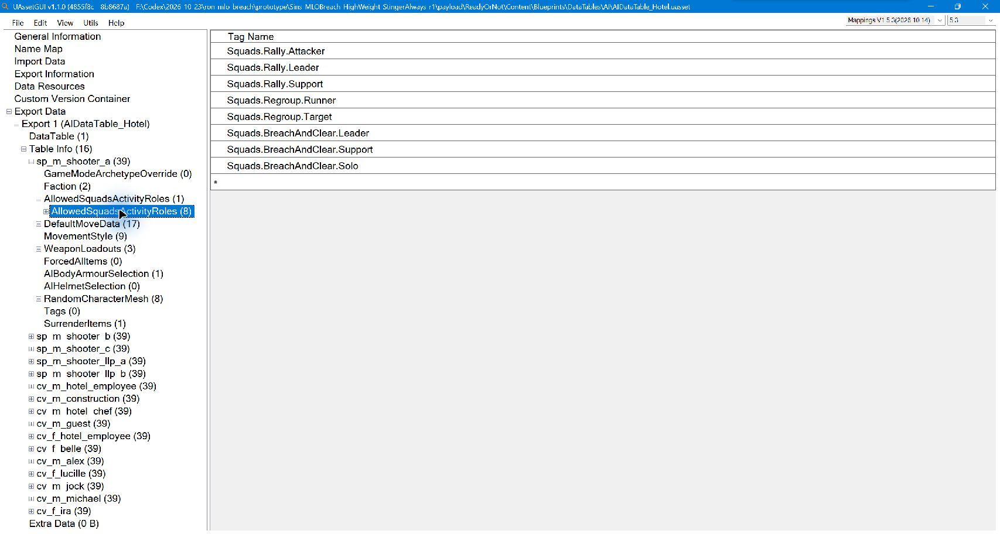

### 3.2 CharacterSpeechHandle

在同一行展开：

```text
RandomCharacterMesh → 0..7 → CharacterSpeechHandle
```

两行各8个模型条目全部改为字符串：

```text
TowerMLO_01
```

一共16处。本次目标行原语音为 `SinsSuspect_01/02`。外观、Body、Head、VoiceModifier 等字段保持。

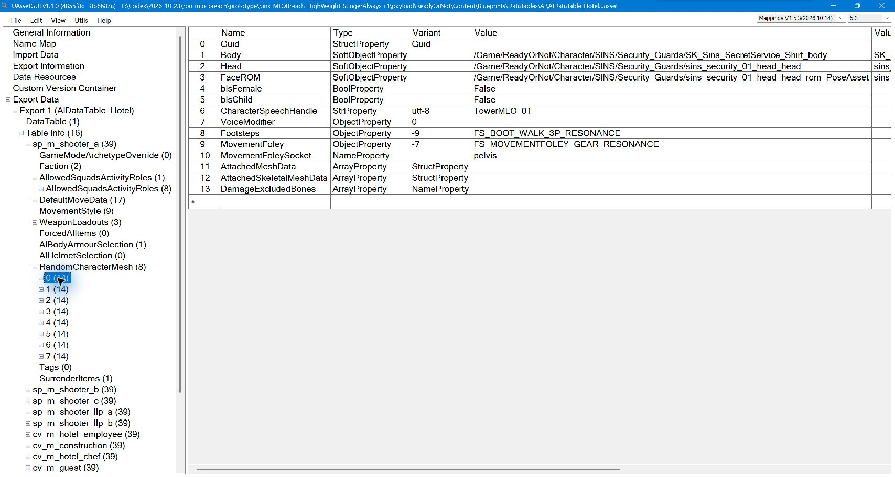

保留 MLO 语音的依据包括官方配置和玩家在“23兆字节”的单变量对照：原有声 NoMute 包能踢门，只有语音值改为静音值的版本变成普通开门。后来已纠正文件标注，NoMute 是有声版。这个观察支持把语音一起接入，但没有证明“声音文件直接驱动脚踢动画”，也没有完整还原所有语音依赖函数。不要用字符串 `0` 代替这项后仍认为行为链相同。

## 4. 给嫌疑人添加什么投掷装备？

仍是 Hotel 两行，展开：

```text
WeaponLoadouts → 每套装备 → Grenades
```

加入三个同样的 `SoftObjectProperty`，完整引用为：

```text
/Game/Blueprints/Items/WeaponsRevised/Grenade_Stinger_V2.Grenade_Stinger_V2_C
```

若界面分开显示软引用字段：

| 字段 | 值 |
| --- | --- |
| PackageName | `/Game/Blueprints/Items/WeaponsRevised/Grenade_Stinger_V2` |
| AssetName | `Grenade_Stinger_V2_C` |
| SubPathString | 空 |

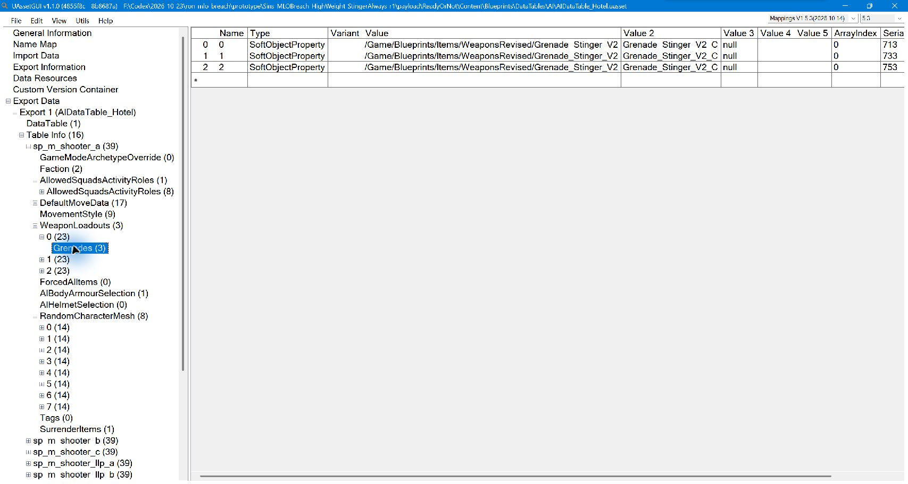

| 行 | 本次备选装备套数 | 每套 `Grenades` |
| --- | --- | --- |
| `sp_m_shooter_a` | 3套，索引0～2 | 3个 Stinger 引用 |
| `sp_m_shooter_c` | 2套，索引0～1 | 3个 Stinger 引用 |

总计五个数组、15个引用，表示每套装备三枚，不是每人一次获得十五枚。要检查每套装备，避免只改第0套而随机生成到另一套时没有投掷物。

**这里加的是原版刺痛弹类，不需要为投弹换一把主枪或发射器。** `Primary`、`Secondary`、`ForcedAIItems` 没有因本次刺痛弹改动而替换。原版投掷活动负责取出并投掷库存里的装备。

原版 Tower 表的 `sp_m_mlo`、`sp_m_mlo_guard` 已有每套三枚 `Grenade_Flashbang_V2_C`。我们参照它的数组结构和数量，将父之罪的空 `Grenades` 数组填入 Stinger；没有全局修改闪光弹类，也没有把新美国所有人的闪光弹都换掉。

## 5. 可选：提高测试时的选取权重

打开三个预设：

```text
Blueprints/AI/ActionPresets/AP_Breach_Leader.uasset
Blueprints/AI/ActionPresets/AP_Breach_Follower.uasset
Blueprints/AI/ActionPresets/AP_SoloBreach.uasset
```

截图中为 `Export Data → Export 7 → AIActionPresetData → Action → Weight`，本阶段把三个预设的值从 `5.0` 改为 `20.0`。这是玩家为了方便测试追加的增强，不是最初接通路径的必需步骤。原来的 Gate、Consideration、Cooldown、CommitTime 和结束逻辑不动。

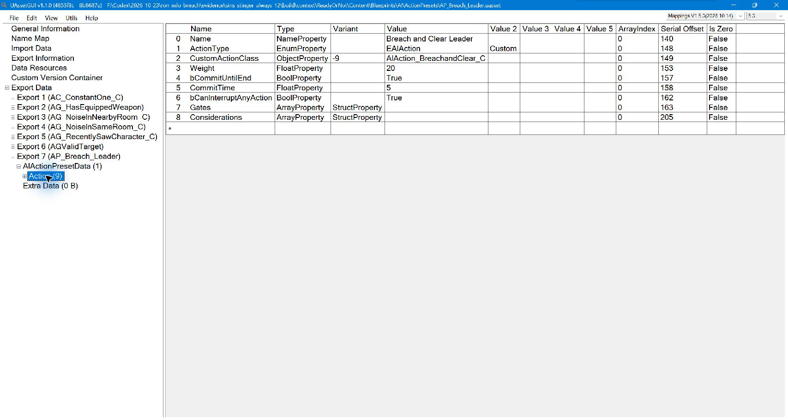

Weight 参与候选竞争，不是20%概率，也不能把5→20说成实测触发率四倍。原型内联 `Data.Weight` 也不是这里修改的那个根预设权重。后续抱团实验又把 Solo 恢复5，那是另一个版本，不能混抄到本阶段表里。

## 6. 踢门后每次启用投掷：改函数，不只改默认值

打开共享官方小队蓝图：

```text
Blueprints/AI/Squads/SquadActivities/BP_Squad_BreachandClear.uasset
```

在 `Export Data` 中找到函数导出 `SetCanUseItem`。本次 GUI 路径为 `Export 17 (SetCanUseItem) → UStruct Data → ScriptBytecode`，对应 UAssetAPI JSON 的0基索引16。以函数名再次确认，不把索引当成跨版本常量。

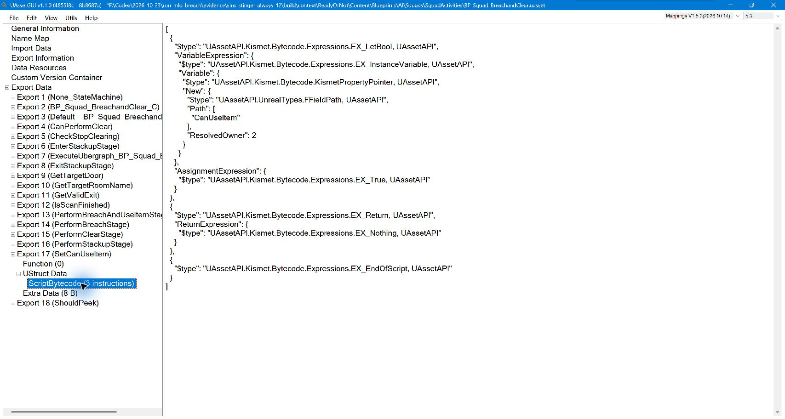

原函数会根据最近 SWAT、领队可见 SWAT 数量、可见队友数量等重算 `CanUseItem`。**只把默认对象的 `CanUseItem` 设为 True，后续仍可能被函数计算覆盖。**

本项目实际把该函数体改为：

```text
CanUseItem = true
return
EndOfScript
```

它的类型化 Kismet 结果是三个表达式：

```text
EX_LetBool
  VariableExpression = 原 CanUseItem 实例变量指针
  AssignmentExpression = EX_True
EX_Return(EX_Nothing)
EX_EndOfScript
```

这里实际使用 UAssetAPI 工具重写并回读，UAssetGUI 用于定位函数和检查结果，并没有在 GUI 中拖动 Unreal Editor 的 Blueprint 图节点。可对照[本次修改代码片段](../examples/enable-grenade-branch.cs)。当前版本原14个表达式变为3个，`ScriptBytecodeSize` 为390→14；不要手工只改长度数值或照抄固定二进制偏移。

工具复用原 `CanUseItem` 变量绑定，以及原 `Return` 和 `EndOfScript`；移除函数内部条件和跳转。原 Ubergraph、函数元数据、其他函数和外部状态机保持，原流程继续：

```text
SetCanUseItem
  → SetUseGrenade(CanUseItem)
  → 原列队与破门流程
  → PerformBreachAndUseItemStage
  → 原版个人投掷/入室执行
```

原版脚踢方式仍为 `EDoorBreachType::Kick = 3`。没有替换踢门动画，没有把个人活动改成 Ram/C2，没有直接跳过踢门调用投掷。

这表示每次该小队活动正常执行许可设置时，启用原版手雷分支。指定哪名成员投掷仍由原逻辑决定，库存耗尽、无法执行投掷、成员失效或战斗中断仍可能导致没有实际投出。它也不自动改独立 SoloBreach 或普通推拉开门流程。

## 7. 保存、回读与打包

阶段12累计修改七个资产，每个保留 `.uasset/.uexp` 配对，共14个文件：

```text
ReadyOrNot/Content/Blueprints/AI/Archetypes/Core/Suspect_Terrorist.*
ReadyOrNot/Content/Blueprints/AI/Squads/DefaultSquadRules.*
ReadyOrNot/Content/Blueprints/DataTables/AI/AIDataTable_Hotel.*
ReadyOrNot/Content/Blueprints/AI/ActionPresets/AP_Breach_Leader.*
ReadyOrNot/Content/Blueprints/AI/ActionPresets/AP_Breach_Follower.*
ReadyOrNot/Content/Blueprints/AI/ActionPresets/AP_SoloBreach.*
ReadyOrNot/Content/Blueprints/AI/Squads/SquadActivities/BP_Squad_BreachandClear.*
```

保存到独立工作副本，重新解析全部目标并检查引用；完整依赖回读与原始 JSON 差异应只落在计划字段和必要布局信息。仅“保存成功”不能代替这些检查。原项目还做了无修改往返、白名单差异、Pak 索引和独立解包比对。

按原挂载路径打包。退出游戏，将旧父之罪候选、同路径 NoMute/其他 AI 包移出 Paks 备份，只启用一个完整版本测试；不要通过修改包名混叠同名资产。

本项目没有改父之罪 `.umap`：当时生成地图存在尚未安全解析的 RawExport，因而选择可完整解析的共享原型、规则、表与预设。这也意味着其他地图只要引用这些共享资产，就可能受影响；“以父之罪测试”不等于完全局限父之罪。

## 8. 实机怎样判断是否真的成功

分开记录：是否选中小队活动、是否两人以上到门旁、是否抬脚踢门、是否投出真实弹体、是否入室、是否恢复其他动作。只看到 `SetBreachMethod(3)`、类已加载、某字段持有 `KickDoorActivity` 引用，都不足以证明实际执行。

父之罪旧高权重版已采到真实 `ActiveSquadActivity = BP_Squad_BreachandClear_C`、当前个人 `KickDoorActivity`，并由玩家回放确认脚踢。阶段12的投掷分支和装备已有离线核验，但本教程不把许可恒真扩大为“每局每门100%投弹”，也不把另一 UE4SS 反击模组的客机反馈搬来作为本破门包的联机验收。详见[证据记录](EVIDENCE.zh-CN.md)。

想理解上述文件怎样一起执行，继续读 [AI 文件夹关系](AI-FOLDERS.zh-CN.md)。
